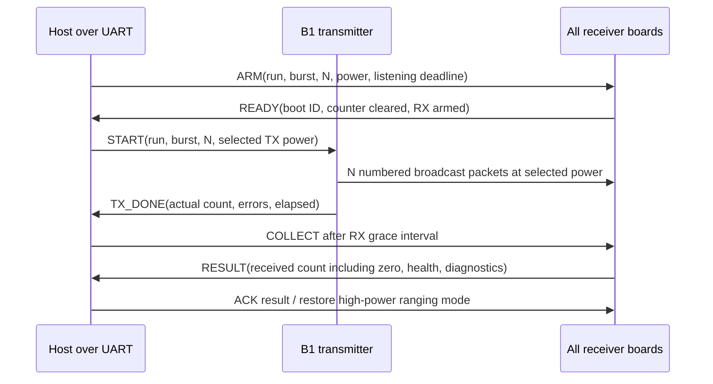

# Execution plan: distance-informed spatial reception control

Prepared 2026-11-11 for the DWM3001CDK experiment in this repository.
Status: **proposed next experiment and firmware work**, not a claim that a
spatial cutoff has already been demonstrated. No firmware is changed or flashed
by this plan.

## 1. The result we are trying to achieve

Put a transmitter and several receivers along a measured line. First range
normally to the receivers. Select the last intended receiver, then choose a
transmit-power setting at which intended receivers decode the data reliably
and receivers beyond the boundary decode very little or none.

For the original example, physical board B1 transmits, B4 is the last intended
receiver, and B5 is the first excluded receiver. B2 and B3 must also receive
reliably. Test B5 and any other monitored receivers beyond it; a passing B5
alone does not prove that every farther position is excluded.

The experiment measures **valid decoded packets**, not the absence of RF energy.
All test receivers stay listening to the same broadcast burst. B5 must not be
made to look silent by ignoring a destination ID, disabling its receiver, or
dropping frames in software.

There are two related outputs:

1. **Control feasibility:** does a single TX setting meet the chosen receivers'
   reception targets at this geometry?
2. **Spatial transition width:** at fixed power, over what measured distance
   does reception change from high to low?

A narrow transition is a hypothesis to test. A broad or non-monotonic response,
or no feasible setting, is a legitimate experimental result.

## 2. What we already know

| Existing evidence | What it supports | What it does not establish |
|---|---|---|
| Checked baseline: 188/188 four-frame exchanges | Range and receiver-side RSSI can be reported together in that implementation | One-way PRR or physical distance calibration |
| Combined 64-setting build: both responders complete a full sweep | Concurrent addressed ranging and a visible RSSI/power trend | A receiver becoming unreachable at the next position |
| At 01010101: both peers completed 10/10 | Poll and Final are still decodable at both present bench positions | Long-term 100% reception, or a reception cliff |
| Current 65-setting build: 340/340 exchanges in 60 seconds | Initial probe plus the next 16 settings ran successfully | A full new 65-setting hardware capture |

The 01010101 run reported median distances of 399 mm and 903.5 mm, and median
corrected RSSI of -86.5195 dB and -84.9235 dB. Those are firmware outputs;
tape-measured antenna separation was not supplied. Do not use them as the
fixture's physical coordinates. See [the exact bench record](checked_combined_bench.md).

Both peers still receiving at 01010101 means the present geometry has not reached
the desired boundary. Adding finer register steps alone cannot demonstrate a
cutoff if even the weakest tested setting is still received by both boards.

The next priority is a trustworthy one-way reception instrument, followed by
moving the receivers to a useful geometry. Keep the existing checked firmware
and artifacts as a fallback.

## 3. Board identities and the three-board pilot

Physical labels, radio IDs and physical positions are separate fields.

| Physical label | Probe serial | Current radio role | Pilot role |
|---|---|---|---|
| B1 | 760201778 | Initiator | Transmitter and ranging controller |
| B2 | 760201915 | Responder ID 0 | Intended near receiver |
| B3 | 760204734 | Responder ID 1 | Far receiver to exclude |

Today we can test B2-versus-B3 separation using the three available boards.
The literal B4-versus-B5 experiment needs **five total boards**: B1 plus four
receivers. A three-board pilot cannot claim that full five-board result.

Initial pilot layout, in metres along the antenna reference line:

```text
B1 / TX                  B2 / peer 0                  B3 / peer 1
x = 0                    x = 1.0                     x = 2.0
                         intended                     excluded candidate
```

These are proposed starting positions, not predicted communication limits.
Use a measured alternative if the available space is shorter. If both still
receive at 01010101, try a more separated geometry such as 0/2/4 m and then
0/4/8 m where space permits, checking high-power reachability each time.
Do not move the boards during a burst or change positions without a new
geometry ID.

The five-board expansion can start with this illustrative arrangement:

| Physical board | Radio ID | x coordinate | Required data behavior |
|---|---:|---:|---|
| B1 | TX/controller | 0 m | Send the common burst |
| B2 | 0 | 1 m | Receive reliably |
| B3 | 1 | 2 m | Receive reliably |
| B4 | 2 | 3 m | Last intended receiver; receive reliably |
| B5 | 3 | 4 m | First excluded receiver; receive little/none |

The controller's target is responder ID 2 in this example, not ID 4.
Store labels explicitly rather than deriving board numbers by adding one to an ID.

## 4. Build a repeatable physical fixture

- Measure from a consistent antenna reference point, not arbitrary PCB edges.
  Mark every position on a tape and record measurement uncertainty.
- Keep antenna orientation, height, PCB posture and cable routing fixed.
  A practical starting fixture is identical nonmetallic supports at approximately
  1.2 m height; use and record another common height if necessary.
- Align antenna reference points along the line. Arrange supports/PCB bodies so
  a nearer board does not physically shield a farther antenna. Photograph the
  setup from above and from the side.
- Keep people and laptops in fixed positions away from the immediate antenna
  paths during capture. Keep the transmitter fixed throughout a spatial scan.
- Start in the most open available line-of-sight area. Record walls, tables,
  floor material and nearby metal; later repeat in a second environment.
- Measure coordinates independently of UWB. Log both tape distance and reported
  ranging distance; do not silently replace physical coordinates with ranging.

Ground reflections and indoor multipath can affect communication and timestamp
behavior even in nominal line of sight. That motivates controlled height,
orientation and later repeat runs. The vendor's [APS006 channel-effects note](https://forum.qorvo.com/uploads/short-url/bVkGY18xEsijUq0OAm6iU64JeqF.pdf)
describes these effects for DW1000 systems; use it as propagation background,
not as a DW3000 register or sensitivity specification.

## 5. Define success before collecting the main dataset

The requested ideal is observed 100% at the last intended board and observed
0% at the next board. Record those literal counts when achieved. For practical
control development, use these initial design thresholds:

| Metric | Proposed criterion |
|---|---|
| Intended receivers | Each has PRR at least 99% |
| Excluded receivers | Each has PRR at most 1% |
| Desired ideal demonstration | N/N at every intended receiver and 0/N at every excluded receiver |
| Exploratory packets per setting | 500, repeated three times |
| Confirmation packets per setting | 1000 per burst, ten predefined bursts |
| Initial packet interval | 10 ms, held constant within a dataset |
| Test payload length | One fixed length, proposed 64 bytes, including the experiment header |
| Baseline PHY | Channel 9, preamble 128, code 9, 6.8 Mb/s, STS off |

These are experimental choices, not previously validated firmware capabilities.
If high-power packet counting cannot sustain 10 ms spacing, use 20 ms for the
baseline experiment and document that change. Do not compare candidate powers
using different packet lengths, intervals or receiver modes.

PRR for receiver i and a valid burst is:

```text
PRR_i = unique valid measurement packets received by i / successfully transmitted measurement packets
```

Normal accepted bursts must have the declared N successful transmissions.
If TX aborts or actual N differs, mark the burst invalid and repeat it; preserve
partial TX/receiver counts for diagnosis rather than quietly changing the
denominator in a comparison table. Duplicate packets do not add to reception.

During exploration, use point PRRs to locate candidate settings. During final
confirmation, freeze the power and geometry and use fresh, predefined windows.
Do not use the same packets both to select the best setting and to claim its
held-out validation result.

## 6. Firmware work required before the main spatial test

The current combined firmware is a good ranging/power reference, but it is
not yet a common broadcast-burst PRR instrument. The older spatial TX/RX apps
contain useful packet-counting concepts but retain known implementation issues.
Do not interpret their missing rows as zeros or flash them as a finished
replacement without the following work.

Proposed new files, **not existing commands or completed implementation**:

| Proposed file/application | Responsibility |
|---|---|
| spatial_line_common | Versioned control/burst format, guards, shared measurement-state definitions |
| spatial_line_init | High-power ranging plus selected-power one-way burst transmitter |
| spatial_line_resp | Ranging responder plus continuously listening packet counter and explicit zero reports |
| tools/run_spatial_line.py | Host coordination across UARTs, run manifest, arming, collection and health checks |
| tools/analyze_spatial_line.py | Per-position/power PRR, confidence bounds, plots and feasibility decisions |

Keep the checked samples unchanged for A/B comparison. Give new wire formats
a new protocol version instead of silently reinterpreting the current version-4
payload. Keep an updated README and artifact-bound bench report beside the new code.

Required changes:

1. Reuse checked frame-length validation, bounded TX/RX waits, guarded state,
   correct overlay and initialization. Reject malformed lengths before copying.
2. Add two explicit radio modes: addressed ranging and broadcast measurement.
   In measurement mode every receiver accepts the common measurement packets,
   regardless of which board the operator selected as the boundary. Use the
   same broadcast address/filtering policy at every receiver; per-recipient
   hardware filtering must not manufacture an apparent RF cutoff.
3. Add host commands to arm a receiver for a known run/burst even when it will
   receive zero UWB packets. A measurement-start frame at weak UWB power cannot
   be the only way an excluded receiver learns about the burst.
4. Put run/session ID, burst ID, sequence, N, power ID/register value, packet
   type and format version in a fixed payload. Use at least 32-bit burst/sequence
   fields and a run identifier; do not rely on the old eight-bit epoch alone.
5. Count each sequence once with a bitmap. Require sequence <N, consistent
   metadata and a fixed maximum supported N. For N=1000, the bitmap is 125 bytes.
6. Record attempted TX, confirmed TX completion, TX faults, receiver resets,
   RX errors/rearming and report status. No unbounded waits.
7. Produce a receiver summary for every host-armed burst, including zero.
   Retain summaries until the host acknowledges collection or explicitly aborts.
8. Begin with RSSI disabled for the PRR instrument. After packet counting passes,
   add optional sampled raw C/N/D, with math/reporting outside packet-critical
   work. Compare diagnostics-on/off counts before enabling it in the main study.
9. Do not log every packet over UART or send a UWB ACK after each packet.
   Receivers must not turn the common one-way burst into colliding exchanges.
10. Start each measurement burst with the exact selected TX register value.
    Keep PG settings/PHY fixed and confirm the logged power matches the applied
    configuration. Reply power in ranging mode remains separate.

The old [spatial RX guide](../samples/spatial_resolution_rx/README.md) documents
length bounds, advertised-N, split-epoch and telemetry issues to avoid. The
[checked C walkthrough](../samples/CHECKED_PROTOCOL.md) explains the tested core.

## 7. Use UART for control and zero reporting first

All three current boards are already connected by USB. For the pilot, use those
UART links for arm/start/collect commands and reports. This avoids depending on
a weak UWB link to report its own failure. BLE can be added after the UART
measurement path is reliable, rather than becoming another unknown immediately.



The host waits for **every** receiver's READY before starting TX. Each receiver
starts listening before TX begins; a shared exact radio clock is unnecessary.
Use bounded commands, an RX deadline longer than N×interval plus measured
overhead, and a final grace interval. Receiver timeout does not erase its summary.
Late arm, early exit or receiver reset invalidates that receiver's measurement.

Host control traffic is wired. High-power ranging packets, where used, are
scheduled outside the test window and have a different packet type. They must
never enter the measurement numerator or denominator.

## 8. Zero, missing and invalid are different outcomes

| Situation | Recorded count / status | Interpretation |
|---|---|---|
| Receiver armed, listened throughout, TX completed N, report says zero | 0/N, VALID | Observed zero decoded measurement packets |
| Receiver reports k unique packets with all health checks passing | k/N, VALID | Measured PRR |
| No UART/BLE report | null, MISSING_REPORT | Unknown, not zero |
| Receiver rebooted, armed late or stopped listening early | null, INVALID_RX_WINDOW | Instrument did not observe the full window |
| TX failed or sent the wrong count/power | null, INVALID_TX | Repeat the condition |
| Run/burst/power metadata mismatch | null, METADATA_ERROR | Do not combine rows |
| Strong-power health/control check fails unexpectedly | CONTROL_FAIL | Investigate hardware/position/telemetry before claiming a cutoff |

Compare boot ID and uptime before/after every burst. Confirm high-power reception
at each new geometry before exploring weak power, and recheck after a block.
Receivers remain on and ready even when excluded. A valid zero report is an
explicit result from a healthy counter, not the absence of a log line.

## 9. Phase A — verify the packet-counting instrument

Keep the three boards at a clearly receiving geometry before searching for a
boundary. Use tape-measured positions and preserve the current ranging record.

1. Build distinct images for TX, responder 0 and responder 1; verify compiled
   IDs, protocol, PHY and image hashes. Flash with west/nrfutil and explicit IDs.
2. Arm both receivers over UART. Send N=100 at a known good setting first,
   then N=1000 at the selected baseline interval.
3. Require matching run/burst/power metadata, exactly N confirmed transmissions,
   two complete receiver summaries and credible counters with diagnostics off.
4. Exercise duplicate and invalid sequence rejection with a controlled test
   mode; duplicates must not increase unique received count.
5. Exercise a **known zero-packet test mode**: arm a complete measurement window
   with no scheduled TX, report its count as a counter-path check. Mark it
   TEST_NO_TX, not a physical 0/N reception measurement.
6. Stop or reset one receiver in a separate test: the host must produce missing/
   invalid status, not zero PRR. Restore it before RF measurements.
7. Check the optional diagnostics path against the no-diagnostics baseline at
   the same PHY/rate. Keep it disabled if it changes PRR through processing loss.

Gate: do not search for a spatial cutoff until these checks pass. When a strong
link loses packets, distinguish software capture/rearm limits from the weak-link
phenomenon the experiment is trying to study.

## 10. Phase B — establish an actual near/far geometry

Use B1 at zero, B2 intended and B3 excluded-candidate. At each geometry:

1. At FEFEFEFE, collect normal ranging to both peers and a high-power broadcast
   baseline. Record distance distributions, not only one reading.
2. Make **01010101 the first low-power measurement condition**, with both
   receivers listening to the same 500-packet burst. Repeat three times.
3. If both receive well at 01, the chosen geometry is not yet useful for
   separation. Increase the farther position or both distances, maintaining
   line of sight and measured positions; repeat the high-power check.
4. If both receive poorly at 01, increase power through the validated ladder
   and identify where the intended receiver recovers. Keep the farther peer's
   count; do not search using the intended receiver alone.
5. If B2 receives well and B3 poorly at any setting, freeze that geometry for
   a systematic power scan. Treat it as an exploratory candidate, not a final pass.

Stop the geometry search at the available space limit. If both still receive
well at the lowest tested setting, report no observed cutoff in the accessible
configuration. Changing PHY, antenna setup or adding attenuation would be a
new experiment, not an invisible continuation of the same condition.

## 11. Phase C — map power versus reception at fixed positions

Do a coarse pass first rather than collecting a large dataset at every code
before knowing where the transition is.

Initial candidate set, written as repeated octets:

```text
01, FE, DE, BE, 9E, 7E, 5E, 3E, 1E, 02
```

01 is the requested starting probe. FE..02 is the coarse-2 ladder; do not treat
the first 01-to-FE jump as one small calibrated step. These are register values,
not dBm. Keep all four octets equal and use the previously tested channel-9
configuration. Do not introduce coarse-3 codes or mix per-frame-section powers
while evaluating a simple reception boundary.

For each candidate, send three separate capture windows of 500 packets to
all receivers. Schedule one initial 01 probe, then use repeated forward/reverse
or randomized setting order to reveal time drift. Record the actual order and
any random seed. Do not change height, distance, orientation or packet parameters.

Find the settings where near/far PRR starts to differ. Test every fine-gain code
in that neighborhood, then expand the scan if the coarse pass missed a useful
interval. If power-response measurements are irregular, use a measured grid
rather than blindly binary-searching register numbers.

Illustrative outcome table, **not an actual result**:

| Setting | Intended PRR | Excluded PRR | Interpretation |
|---|---:|---:|---|
| P_a | 100% | 100% | Too much reception beyond the boundary |
| P_b | 100% | 40% | Still too much far reception |
| P_c | 99.8% | 0.4% | Exploratory candidate for 99%/1% targets |
| P_d | 82% | 0% | Intended receiver is no longer reliable |

An interval of passing settings is preferable to a lone unstable setting. Use
exploration data to nominate one setting with margin, then freeze it before
fresh confirmation. If no setting satisfies both receivers, record the closest
tradeoff and expand spacing; do not label a software address filter a solution.

## 12. Phase D — measure spatial transition width at fixed power

This phase answers how sharply reception changes with position. **Do not retune
power at every position**, because that would move the boundary being measured.

1. Fix B1, the selected power, PHY, packet length, interval and orientation.
2. Scan receiver positions coarsely until the curve contains a high-reception
   region and a low-reception region.
3. Collect repeated PRR windows at every position and retain run order.
4. Refine the region where PRR falls, using steps such as 50 cm, 20 cm, 10 cm,
   then 5 cm if fixture accuracy and repeatability justify it.
5. Revisit earlier positions in reverse or randomized order. Do not mistake
   temporal fading for a distance-dependent change.

With only three boards, use B2 as a fixed near reference and move B3 through the
scan positions. This is a **sequential position scan**, not simultaneous sensing
of every position. The fixed reference helps detect drift, but it does not remove
all time variation. Keep B3's hardware/orientation constant during that scan.

To preserve both a high and a low spatial anchor while probing a third position
simultaneously, we would need TX plus three receivers: four boards. Do not imply
that the present three-board setup can maintain three independent RX positions.

If the measured curve is approximately monotonic, bracket the transition and
sample its midpoint to refine it. If there are reception islands or reversals,
use a denser grid and report the complete pattern. A single bisection boundary
is not an adequate description of non-monotonic reception.

### Report two different widths

Use 95% and 5% PRR crossings to characterize the transition shape:

```text
W_95_to_5 = distance_at_5_percent - distance_at_95_percent
```

Use 99% and 1% for the stricter operating boundary. Those threshold pairs need
not give the same width. If a crossing is outside the scanned range, report it
as unobserved/bounded, not an extrapolated precise number.

If the 95% crossing lies between measured positions a and b, and the 5% crossing
between c and d, then, under the monotonic interpretation:

```text
distance_95 in [a,b]
distance_05 in [c,d]
W_95_to_5 in [max(0,c-b), d-a]
```

State the sampling pitch, positional measurement uncertainty and PRR uncertainty
with this bracket. A 5 cm sampling step is not by itself proof of 5 cm spatial
resolution. Interpolation may be shown as a fitted estimate, separately from
the bracket supported by actual measurements.

## 13. Phase E — confirm a candidate with fresh data

For a nominated power/geometry, collect ten predefined bursts of 1000 packets.
At 10 ms spacing, each burst has roughly ten seconds of scheduled packet gaps,
plus TX/control/report overhead. Leave a short interval between bursts and keep
positions and power fixed. Record per-burst counts as well as the aggregate.

The desired demonstration is 1000/1000 at intended receivers and 0/1000 at
excluded receivers in each window. Also evaluate the practical 99%/1% thresholds.
Record a failed window as a failed window; do not restart repeatedly until a
good sequence of windows appears and discard the earlier attempts.

### Finite observations and confidence

For zero observed receptions in N independent identical-probability trials,
the one-sided 95% upper bound on reception probability is `1-0.05^(1/N)`.
For N/N receptions, the corresponding lower bound is `0.05^(1/N)`. These are
endpoint cases of exact binomial bounds; see [NIST's exact-binomial reference](https://itl.nist.gov/div898/software/dataplot/refman2/auxillar/exacbino.htm).

Computed examples:

| N | All-N success: lower bound | Zero-N reception: upper bound |
|---:|---:|---:|
| 10 | 74.113% | 25.887% |
| 100 | 97.049% | 2.951% |
| 300 | 99.006% | 0.994% |
| 1000 | 99.701% | 0.299% |
| 3000 | 99.900% | 0.100% |

Thus the existing 10/10 observation demonstrates reception; it is not evidence
that true reception is guaranteed to be 100%. For nonzero failures/receptions,
compute the appropriate bound from the actual counts rather than applying the
zero-event formula. [NIST's confidence-interval guidance](https://www.itl.nist.gov/div898/handbook/prc/section2/prc241.htm)
also explains why simple symmetric approximations can mislead at extreme counts.

To make a joint 95% statement about m receiver constraints, one conservative
choice is per-constraint one-sided alpha=0.05/m. With only the near/far pair,
alpha=0.025 gives bounds of approximately 99.632% and 0.368% after 1000/1000
and 0/1000 respectively. This joint adjustment is a proposed analysis rule;
freeze the rule before confirmation rather than choosing it after seeing data.

Packet outcomes can be correlated by fading, processing stalls or environmental
changes. The binomial model assumes independence and a common probability;
see [NIST's binomial definition](https://itl.nist.gov/div898/handbook/glossary.htm).
Always show per-burst variation and repeated time blocks, not only an impressive
pooled interval. If independence is implausible, treat packet-level bounds as
conditional model summaries and emphasize block-level repeatability.

## 14. Phase F — test the literal board-4/board-5 arrangement

Add B4 and B5 only after the three-board instrument and near/far pilot work.
Use one transmitter and four distinctly identified receivers; record new probe
serials rather than guessing or reusing the present three-board mapping.

1. Place the five boards at the measured line positions. Start at a generous
   pitch, for example 1 m, rather than immediately demanding centimetre spacing.
2. At FEFEFEFE, range to all four receivers and verify high-power broadcast
   reception. Associate physical labels with radio IDs and coordinates.
3. Select B4, responder ID 2, as the last intended receiver.
4. Send the **same broadcast burst** to B2, B3, B4 and B5 at each candidate power.
5. Require B2/B3/B4 all to pass the intended criterion and B5 to pass the
   excluded criterion. Do not judge the setting from B4/B5 alone.
6. Freeze a candidate and run the fresh confirmation block. If successful,
   progressively shrink only the B4–B5 separation or reposition the boundary
   under a new geometry ID. Retune power only in a separately identified search
   phase; keep it fixed during each spatial-width scan.
7. Swap the physical hardware at B4/B5, preserving position-specific orientation,
   and repeat. Keep immutable hardware IDs and position labels separate in logs.
8. Where possible, test positions beyond B5 with an additional receiver or a
   documented sequential scan. Do not extrapolate universal exclusion beyond
   the last measured board.

If B5 is stronger than B4 because of orientation, hardware or reflections, the
desired condition may be infeasible. That is why all receiver results and board
swaps are part of the experiment rather than assuming distance orders RSSI.

## 15. Why fine spatial separation may be difficult

As an illustrative free-space equal-gain model, differential path loss is:

```text
delta_PL_dB = 20*log10(distance_far / distance_near)
```

This is a model calculation, not a fitted law or a prediction for this room.

| Near/far distances | Model differential loss |
|---|---:|
| 1 m / 2 m | 6.02 dB |
| 4 m / 5 m | 1.94 dB |
| 4 m / 4.1 m | 0.214 dB |
| 8 m / 8.1 m | 0.108 dB |

Starting with a widely separated pilot pair gives a larger nominal difference
than starting with receivers only centimetres apart. The actual experiment can
deviate from the model. Do not turn a register increment into assumed dB, or
convert the RSSI estimates directly into a reliable distance cutoff.

The experiment's spatial discrimination is different from UWB ranging precision.
A device reporting centimetre-scale ranging changes does not imply that its
packet-reception probability switches from one to zero across that same distance.

## 16. Phase G — close the loop using distance and PRR

Implement this only after a repeatable open-loop PRR dataset exists.

```text
High-power discovery/ranging
    -> associate IDs with intended/excluded positions
    -> choose the last intended receiver
    -> choose an initial candidate from the measured power/PRR map
    -> arm every receiver
    -> transmit a numbered burst at the candidate power
    -> collect explicit counts and health from every receiver
    -> evaluate intended and excluded criteria
    -> accept, adjust, or report no feasible setting
```

Distance supplies an initial guess using the empirical calibration map, not
an exact register-to-range formula. When receivers are close together, use
fixture labels/coordinates to validate order rather than sorting one noisy
ranging sample and assuming it defines ground truth.

For power P, the practical point-estimate feasibility check is:

```text
min(PRR_i(P) for every intended receiver i) >= 0.99
max(PRR_j(P) for every excluded receiver j) <= 0.01
```

For confirmation, replace intended PRR with its lower confidence bound and
excluded PRR with its upper confidence bound under the declared analysis model.
If only one receiver is tested beyond the target, the claim applies to that
receiver/position, not to every possible farther receiver.

Adjustment rules:

- Intended receivers fail, farther receivers quiet: try a stronger valid setting.
- Intended receivers pass, farther receivers leak: try a weaker valid setting.
- Both criteria pass: freeze the candidate and run held-out confirmation.
- No tested setting satisfies both: recheck measurement health, then report
  infeasible for this geometry/PHY; widen the spacing or change the experiment.
- Repeated contradictory outcomes: repeat controlled blocks before adjusting;
  do not chase each individual fading event with a new power setting.

Prefer an empirical interval of passing settings with neighboring-setting
checks. A numeric midpoint across arbitrary coarse/fine register codes is not
a calibrated power midpoint. Do not add an endless increase/decrease loop or
retune based on one RSSI reading.

Normal ranging/control at FEFEFEFE is intentionally audible farther away.
The initial experiment's exclusion claim therefore applies to **measurement/data
windows**, not to maintenance packets outside them. If the requirement becomes
that B5 must never decode any later UWB packet, use wired control and clearly
separate the initial discovery phase; periodic high-power discovery would violate
that stronger requirement.

## 17. Data to save for every condition

Use a new run directory per firmware/configuration/geometry session. Proposed
layout, not files already produced by the current capture tool:

```text
captures/spatial_line/<run_id>/
    manifest.json
    geometry.csv
    tx.log
    receiver_<hardware_id>.log
    bursts.csv
    packet_sequences.csv or per-burst bitmaps
    analysis.json
    figures/
    setup_photos/
    NOTES.md
```

Minimum per-receiver/per-burst row:

```text
run_id,geometry_id,burst_id,hardware_id,radio_id,position_label,x_m,height_m,tx_power_hex,payload_bytes,interval_ms,n_declared,n_tx_completed,n_unique_rx,n_duplicates,n_bad_metadata,n_rx_errors,boot_id,status,prr,rssi_valid_samples,rssi_median_db
```

Manifest fields should include image hashes, source revision/hashes, compiler
configuration, channel/preamble/code/data rate/STS, PG settings, antenna delays,
target board, intended/excluded receiver sets, actual setting order, report/arm
timeouts, start/end times, environment and fixture uncertainty. RSSI is null when
no valid samples exist; a zero-reception burst does not have a measured RSSI.

A missing/invalid row has PRR null and an explicit status. Keep TX attempts and
raw receiver counts even when excluding a burst from the main plot. Include
control phases in logs, clearly labeled outside measurement windows.

The current analyzer handles checked exchange logs. It must not be repurposed
by calling its TWR completion counts one-way PRR; add a schema-aware burst analyzer.

## 18. Plots and final result table

Generate standalone figures and their underlying CSV, with settings annotated:

1. PRR versus TX setting for each receiver at fixed geometry. Use an ordered
   categorical/code axis unless power has been independently calibrated.
2. A position × TX-setting heatmap of PRR, highlighting intended/excluded positions.
3. PRR versus measured distance at the frozen power, with repeated bursts,
   uncertainty and threshold/crossing brackets.
4. RSSI distributions versus position/power for successfully received packets,
   with the valid sample count. Missing RSSI at low PRR is not minus infinity.
5. Per-burst time series to show fades, resets and drift hidden by aggregation.

Final summary fields:

| Field | Report |
|---|---|
| Geometry / environment | Measured positions, height, orientation, photos and date |
| Boundary | Physical target label, first excluded label, their IDs and separation |
| Selected TX register | Exact repeated-byte word and unchanged PG/PHY settings |
| Intended/excluded reception | Counts, point PRR, declared confidence bounds and number of valid windows |
| Invalid/missing windows | Counts and reasons, not silently removed |
| Spatial transition | 95→5 bracket, 99→1 operating gap, position uncertainty and sampling pitch |
| Repeatability | Reverse scan, hardware swap and later-time results |
| Conclusion | Feasible with margin, fragile/conditional, or no feasible setting found |

Do not report a guaranteed hard radius from a single successful near/far pair.
Report the tested geometry and measurement conditions.

## 19. Ordered implementation and experiment checklist

| Step | Work | Evidence required to proceed |
|---|---|---|
| 1 | Preserve current checked artifacts and tape-measure a three-board fixture | Probe map, photographs, coordinates and baseline ranging logs |
| 2 | Implement common broadcast bursts and host arming | Versioned format; bounded TX/RX; exact frame lengths; unique counting |
| 3 | Implement explicit zero/missing/invalid reporting | Controlled no-TX and reset/report-loss tests classified correctly |
| 4 | Verify strong-link instrument behavior | Correct N and healthy summaries from both real receivers |
| 5 | Test 01010101 and locate a useful near/far geometry | Repeated one-way PRR, not only completed ranging |
| 6 | Scan candidate powers with positions fixed | Per-peer per-setting counts and identified feasible interval or tradeoff |
| 7 | Freeze power and map the transition spatially | Repeated position scan with actual crossing brackets |
| 8 | Run fresh confirmation and hardware-swap controls | Predeclared windows, uncertainties and retained failures |
| 9 | Expand to B1..B5 | B2/B3/B4 pass together while B5 meets exclusion target |
| 10 | Add distance-informed closed-loop selection | Controller converges or explicitly reports infeasible; independent confirmation |

The next coding task should be **steps 2–4**, starting from the checked radio
core and the existing spatial counter ideas. Another ranging-only power sweep
does not resolve the missing one-way reception measurement.

## 20. Practical first lab session

Once the new counter/arming firmware passes its instrument checks:

1. Use the three known probes; B1 at 0 m, B2 near and B3 farther on the measured line.
2. Capture high-power normal ranges and a broadcast reception baseline.
3. Send three 500-packet bursts at 01010101, with explicit reports from both receivers.
4. If both receive everything, move B3 farther under a new geometry ID and repeat
   the strong-power check and low-power test. Stop at the space limit if needed.
5. Once reception differs, hold the positions and scan the neighboring valid powers.
6. Keep a fixed power for a separate position scan, then confirm a candidate
   with fresh 1000-packet windows.

The first useful milestone is a trustworthy table saying **what each receiver
decoded from the same transmitted burst**, including explicit zeros and missing
reports. That is the evidence needed to decide whether the desired line boundary
exists and whether distance can help select it.
