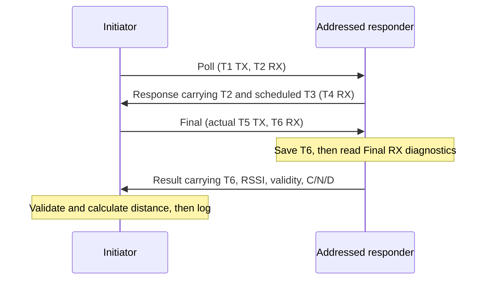

# Reading the checked C implementations

The five checked families are independent source copies: baseline, power-only,
multi-only, combined and fixed01. Each has checked.c, checked.h and a corrected board
overlay in its own common directory. Application main.c files delegate to
checked_run; role selection is a compiler definition in each role's CMake file.
Read [the index](README.md) for matching applications and validation records.

## Exchange and timestamp ownership



Response and Final are delayed transmissions using 159744000 device ticks,
which is 2500 SI microseconds. The responder waits a further three milliseconds
after diagnostics before immediate Result transmission, allowing the initiator
to arm RX. Do not move print statements into the RX-to-delayed-TX window.

| Timestamp | Clock domain | How this implementation obtains it |
|---|---|---|
| T1 | Initiator | Actual Poll TX timestamp |
| T2 | Responder | Poll RX after CIA completion |
| T3 | Responder | Delayed Response schedule, low-bit alignment plus TX antenna delay |
| T4 | Initiator | Response RX after CIA completion |
| T5 | Initiator | **Actual** Final TX timestamp after TX completion |
| T6 | Responder | Final RX after CIA completion, saved before diagnostics |

Final also carries T4 and predicted T5, but the initiator's distance calculation
uses actual T5 from hardware. Result RX needs no local timestamp for DS-TWR;
the useful measurement is the remote responder's already saved Final T6/RSSI.
This is why a local Result CIA/RSSI read is not part of the checked initiator path.

checked.h forms four same-domain modular intervals:

```text
r1 = (T4-T1) & ((1<<40)-1)
d1 = (T3-T2) & ((1<<40)-1)
r2 = (T6-T3) & ((1<<40)-1)
d2 = (T5-T4) & ((1<<40)-1)
tof_ticks = (r1*r2-d1*d2)/(r1+r2+d1+d2)
distance_m = tof_ticks * 299702547/(499.2e6*128)
```

Products are calculated in double after positive/nonzero bounded interval
checks. Each interval must be no greater than 3194880000 ticks (50 ms).
Never subtract an absolute timestamp belonging to one board from another
board's absolute timestamp. get_le/put_le handle little-endian serialization;
the host math test exercises independent epochs and 40-bit wraps.

## Function map

| Function/helper | Job and constraint |
|---|---|
| checked_run | Initialize guards/radio; select peer and power if applicable; execute, validate, count and log |
| header | Encode magic, version, frame type, peer and 32-bit sequence |
| receive | Wait for RX outcome, require exact wire length before copying, then validate header and sequence |
| precise_rx | Require CIA completion/error outcome before reading a ranging RX timestamp |
| timestamp | Read five timestamp bytes and verify guarded state |
| schedule_after | Program delayed TX and calculate its predicted timestamp including antenna delay |
| send | Write bounded own-frame payload, arm immediate/delayed TX, check start result and wait for completion |
| arm_rx | Clear relevant status and enable RX with a radio timeout |
| wait_bits | Poll status with a host-time deadline; reject error bits and memory-guard corruption |
| clean | Force TRX off, clear relevant status and return guarded completion/error state |
| capture_rssi | Responder-only; read Ipatov diagnostics after saving Final RX timestamp |
| exchange | Role-specific four-frame transaction, returning a classified result |
| checked_distance | Form bounded modular intervals and compute finite distance |
| intact / sequence | Check buffer/state/diagnostic canaries and sequence/inverse consistency |
| select_peer | Multi/combined/fixed01; maintain selected peer and inverse guard |
| apply_power | Power/combined/fixed01; write repeated-byte TX_POWER and fixed PG settings |
| summarize_level | Power/combined/fixed01; emit a completed dwell's counts and valid-RSSI mean |

Canaries are useful detection, not proof that every memory error is impossible.
Not every state/counter is independently duplicated. Stack protection/assertions
also help detect faults without constituting a complete memory-safety mechanism.

## Frame layout and association

All payloads begin with nine bytes: `C7 51 version type peer seq32_le`.
Versions are 1 baseline, 2 power, 3 multi, 4 combined, and 5 fixed01.

| Frame | Type | Payload length | Data after the header |
|---|---:|---:|---|
| Poll | 1 | 9 | None |
| Response | 2 | 19 | T2[5], predicted T3[5] |
| Final | 3 | 19 | T4[5], predicted T5[5] |
| Result | 4 | 26 | T6[5], RSSI signed32, valid byte, C32, N16, D8 |

Lengths exclude the two-byte hardware FCS. The exact received wire length is
checked against payload+FCS **before** subtraction/copying. The responder adopts
the sequence from a valid addressed Poll; subsequent frames must match it.
The initiator accepts only the expected peer/type/sequence. The protocol is
not an authenticated network layer; current checked PHY has STS disabled.

## Diagnostics and interpretation

The receiver first saves Final T6, then reads dwt_nlos_alldiag into a guarded
static structure. Result carries raw C/N/D as well as the baseline estimate:
`10*log10(C*2^21/N^2)-121.7`, multiplied by 1000. The power, combined and fixed01
initiators add `6000*D` to produce rssi_dgc_mdB when valid. This follows the
reference vendor DGC model and remains uncalibrated. Baseline and multi-only
retain their original estimate for controlled comparison.

Invalid diagnostic output is marked diag=0 and RSSI INT32_MIN. Preserve those
flags and raw values rather than averaging sentinels into a valid-looking result.
Distance output rejects values below -2 m or above 100 m as errors; smaller
negative distances remain visible for calibration rather than being clipped.
Stable reported distance is not an independently measured physical separation.

## Scheduling differences

| Family | Peer selection | Power schedule | Dwell/counting |
|---|---|---|---|
| Baseline | One ID, default 0 | Fixed inherited radio configuration | Global attempts/completions |
| Power-only | One ID, default 0 | FE DE BE 9E 7E 5E 3E 1E 02 | 20 attempts per level; advance on failure too |
| Multi-only | attempt modulo responder count | Fixed inherited radio configuration | Global and per-peer counters |
| Combined | attempt modulo responder count | 01 first, then FE..02 fine codes at coarse 2 | 10 attempts per peer per level by default; per-peer dwell summaries |
| Fixed01 | attempt modulo 2 | Always 01 for all four frames | 20 attempts per peer per reporting window; cycle changes without changing power |

The combined plan derives level from the zero-based attempt divided by
responders × attempts_per_peer, then modulo 65. Cycle divides by the whole
1300-attempt default cycle. It therefore completes whole peer rounds at one
setting before advancing. The 01 entry is a separate coarse-gain probe, not
part of the descending coarse-2 ladder. Combined-sweep responders always transmit
at FEFEFEFE. In the separate current fixed01 experiment, responders also use
01010101. Its earlier FE-reply trial is retained as a historical configuration.

The 32-bit sequence and attempt counters eventually wrap; the host continuity
check handles sequence wrap. A boundary after billions of attempts can truncate
a scheduled dwell because the schedule derives from the wrapping attempt
counter. Current bounded captures do not validate continuous multi-year behavior.

## Reporting and verification

Measurement printk records bypass the deferred log queue with CONFIG_LOG_PRINTK=n.
Normal driver logs remain deferred. This avoids the dropped measurement records
seen when a busy polling responder did not service deferred printk logging.
Main stack is 4096 bytes, heap 8192, FPU/sharing enabled, with assertions and
hardware stack protection in the checked configurations.

Errors: 1 host timeout, 2 radio error/timeout, 3 length, 4 header/type/peer,
5 sequence, 6 CIA completion, 7 delayed TX, 8 interval, 9 memory guard,
10 range outside bounds. Error records count as attempts and must not be dropped
when comparing completion rates. The transaction can fail on either direction;
completed DS-TWR is not one-way PRR.

Use [host tools/tests](../tools/README.md) for schedules, math and log analysis,
then the matching bench records for actual hardware evidence. None of these
checks identifies a unique internal driver cause for all historical RSSI failures.
